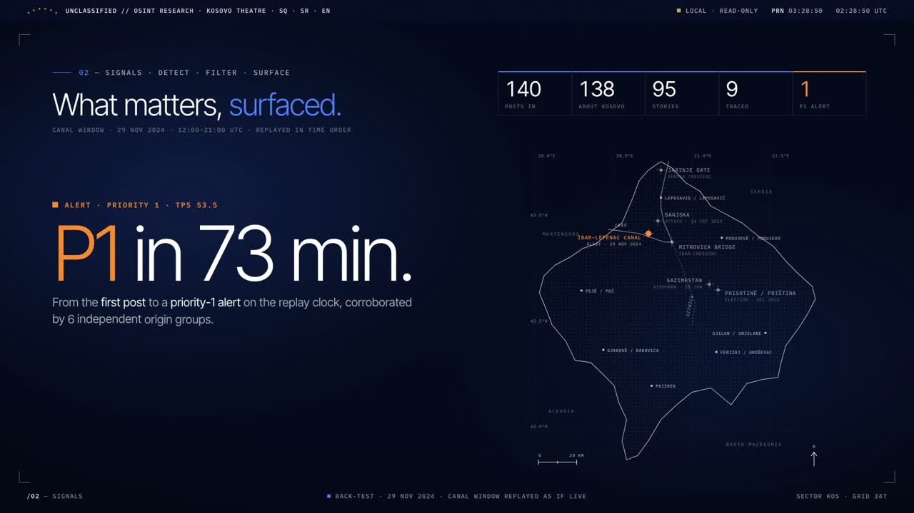
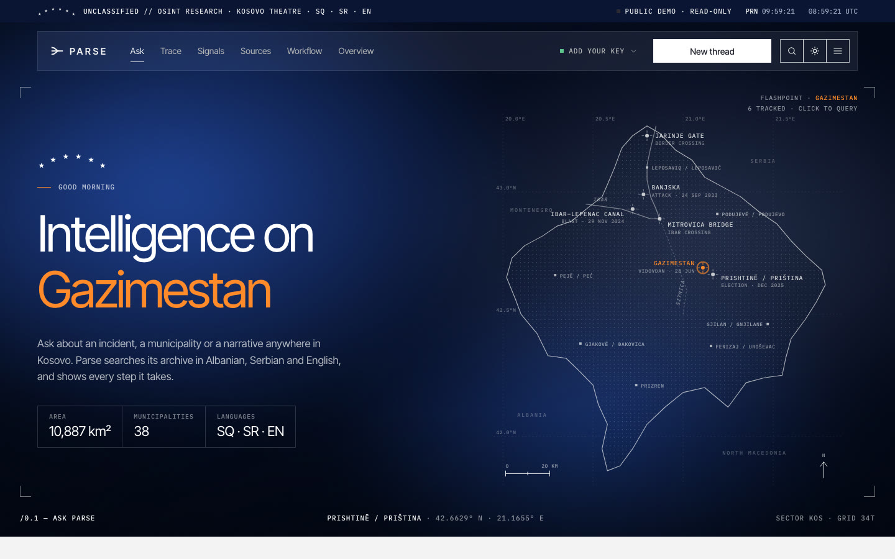
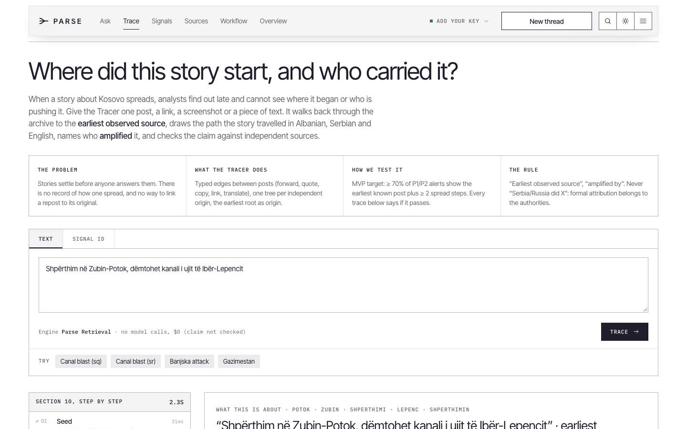

# Parse

**OSINT early warning for Kosovo.** Parse collects public reporting in Albanian, Serbian (Latin and Cyrillic), Russian and English,
archives it with a SHA-256 hash, finds the earliest observed source of a story, scores how significant it is, and checks the claim
against independent sources. Spread and truth are scored apart: a false story that spreads fast is still an alert.

### [**Open the live demo → parse-osint.vercel.app**](https://parse-osint.vercel.app)

<p align="center">
  <video src="https://github.com/Dielldev/parse/raw/main/docs/media/parse-agentic-loop.mp4" poster="docs/media/parse-agentic-loop-poster.jpg"
         width="840" controls muted playsinline>
    <a href="docs/media/parse-agentic-loop.mp4"></a>
  </video>
  <br><sub>30 seconds: agents → signals → ask. Every number on screen comes from a real run
  (<a href="docs/media/parse-agentic-loop.mp4">mp4, 23 MB</a>; made with <a href="video/agentic/README.md">video/agentic</a>).</sub>
</p>

<p align="center">
  
  
</p>

## The problem

When a threat-relevant story starts spreading online, analysts hear about it hours or days late and cannot see where it began or who is
pushing it. The posts are scattered across news sites, official pages and social media, in several languages and two scripts.

Parse answers three separate questions, each in a measurable way:

| Question | How Parse answers it |
|---|---|
| **Is this post threat-relevant?** | Threat labels T1–T10 and narratives N1–N11 from a model, with the rights rule built in: lawful protest, journalism and opposition politics are never threats on their own. |
| **Is it big enough?** | Statistics, not a model's mood: velocity against that narrative's own baseline, independent origins, cross-platform spread, coordination, proximity. These feed a Threat Priority Score (TPS) and tripwires into bands P1–P4. |
| **Is it true?** | Evidence from independent sources in a hand-checked registry, with a verdict (CONFIRMED, CORROBORATED, DISPUTED, DEBUNKED, UNVERIFIED) decided by fixed rules. A model only labels whether a text supports or contradicts a claim; it never decides truth. |

## Try the demo

The [live demo](https://parse-osint.vercel.app) runs the real code on a read-only snapshot of the archive:
**33,285 signals** from **108 registry sources**, ten windows (Banjska 2023, the Ibar–Lepenac canal 2024, the December 2025 election,
Gazimestan 2026 and six quiet windows).

| Page | What you can do | Needs a key? |
|---|---|---|
| **Ask** | Ask “What happened at Banjska?” and watch every step: normalise, registry, search, rank, evidence hashes, spread, brief. Cited, deterministic, no model. | No |
| **Trace** | Paste a post (any language) or a signal ID. Parse builds the spread graph, picks the earliest observed source, finds amplifiers, scores significance and writes a brief. | No (claim check and AI brief: yes) |
| **Agents** | Send a scout to a Telegram channel or a subreddit, or a fleet of agents to the news sites, and watch every step and post arrive. A **replay** of runs the real agents recorded: nothing is fetched. | No |
| **Signals / Sources** | Browse and filter the corpus and the tiered source registry. | No |
| **Workflow** | Play with the real TPS and verdict logic. | No |
| **Run a model** (on any signal page) | Label, detect, translate, or check a claim with open Qwen models. | **Yes, yours** |

### Bring your own key

Parse's model features call open Qwen models on [Featherless](https://featherless.ai). **No model is hosted on this site and the server has
no key of its own.** Open **Add your key** (top right), paste your Featherless API key, and the model buttons work, billed to your account.

* The key stays in **this tab only** (`sessionStorage`). Closing the tab forgets it.
* It is sent over HTTPS, **only** with the few requests that run a model (`/api/trace`, `/api/signals/*/model/*`, `/api/key/check`),
  as a header, never in a URL or a body.
* The server holds it in memory for that one request, forwards it to Featherless, and drops it. It is **never stored or logged**.
* Nothing a visitor does is saved: model outputs and traces are returned inline and discarded.
* Use a key with a low spend limit anyway. A typical click costs a fraction of a cent.

## How it works

```
Collect ──▶ Archive ──▶ Normalise ──▶ Detect ──▶ Cluster & trace ──▶ Score ──▶ Verify ──▶ Alert
registry    SHA-256     language ID,   T1–T10,    typed edges:        TPS +     fixed-rule  a human
sources     write-once  Cyrillic→Latin N1–N11     forward · quote ·   tripwires verdict     decides
only        evidence    translation               copy · link ·       P1–P4
                                                  translate
```

* **Registry only.** Every source has a tier: 0 official or primary, 1 established outlet, 2 specialist OSINT, 3 partisan or unverified, with a bias note.
  Nothing outside the registry is collected. `robots.txt` and rate limits are respected, and there are no logins or fake accounts.
* **Tracer.** Builds the spread graph from one post, link, screenshot or text, collapses reposts into origin groups, and reports the
  *earliest observed source* and who *amplified* it. It never says a state “did” something.
* **Watch.** Replays an archived incident in time order as if live, to measure how early Parse would have raised the alert
  (the canal window reaches P1 about 73 minutes after the first post).
* **Models.** Qwen3-8B labels and writes briefs, a Qwen3.5-4B classifier gives probabilities, Qwen3-4B translates, LightOnOCR reads images,
  Qwen3-Embedding finds near-duplicates. Roles and prices are in [`config/models.yaml`](config/models.yaml).
* **Guardrails are code.** Registry gate, write-once audit log, attribution wording, and a spend cap that stops model calls.

See [`docs/WATCH_AND_TRACE.md`](docs/WATCH_AND_TRACE.md) for the Watch and Tracer walkthrough and
[`PARSE_BUILD_PROMPT.md`](PARSE_BUILD_PROMPT.md) for the full build brief.

## Web demo vs the full pipeline

| | Web demo (Vercel) | Full pipeline (your machine) |
|---|---|---|
| Data | Read-only SQLite snapshot, text cut to 1,200-character excerpts that link to the original | Postgres + pgvector, full text, write-once evidence files |
| Models | Your Featherless key, per request | `FEATHERLESS_API_KEY` in `.env`, with a budget cap |
| Collection | None | Field agents, RSS, sitemaps, WordPress APIs |
| Watch | Not included | Included |
| Agents | Replay of recorded runs over the snapshot (no network, no browser) | Live browser scout and per-site agents |
| Tracer inputs | Archived signal, pasted text | Also links and screenshots (OCR) |
| Embeddings, translate edges | Not included | Included |
| Persistence | None | Everything is archived |

## Security of the web demo

The demo is built for strangers to use, so it assumes they are not friendly. What is in place:

* **No server-side secret.** There is no model key on the server; only the visitor's own, per request.
* **Read-only data.** SQLite opened with `mode=ro` and `PRAGMA query_only`; pending writes are discarded; no evidence files are shipped.
* **No outbound fetching** except Featherless at a fixed host: link and screenshot tracing, image OCR, live field agents and Watch are off, so there is no SSRF surface. The Agents page only replays what the real agents already archived.
* **Strict headers.** Nonce-based `Content-Security-Policy` (no inline-script allowance, `connect-src 'self'`, `frame-ancestors 'none'`), HSTS,
  `nosniff`, `X-Frame-Options: DENY`, `Referrer-Policy: no-referrer`, a locked `Permissions-Policy`, and `no-store` on pages and API answers.
* **Input limits.** Body size cap, only GET/HEAD/POST, key-shaped headers only, capped lengths on every text field.
* **Rate limits** per visitor (best effort per serverless instance) on top of per-visitor model limits. Cost is the visitor's own, never the host's.
* **Escaped output.** Scraped text is untrusted: templates auto-escape and the scripts escape every field they render, with the CSP as a second line.
* **Tests.** [`tests/demo`](tests/demo/test_demo.py) checks the headers, nonces, limits, disabled routes, key handling and that writes are dropped.

Known limits: rate limiting is in memory per instance, so it slows abuse but is not a hard global cap; and a deployment operator can in principle
see a key in transit, as with any proxy, which is why the key panel tells visitors to use a low-limit key.

## Run it yourself

### The web demo, locally

```bash
uv sync
PARSE_DEMO=1 uv run python -m uvicorn parse.web.app:app --port 8000
```

Open <http://localhost:8000>. It reads `demo/parse_demo.sqlite.gz` (unpacked to a temp file on first start).

### Deploy your own copy to Vercel

```bash
vercel deploy --prod
```

[`vercel.json`](vercel.json), [`api/index.py`](api/index.py) and the slim [`requirements.txt`](requirements.txt) are all it needs; `.vercelignore`
keeps the bundle to the code, config and snapshot. No environment variables are required.

### The full pipeline

```bash
cp .env.example .env              # add FEATHERLESS_API_KEY for model runs
docker compose up -d              # Postgres + pgvector on :5433
uv sync
uv run alembic upgrade head
uv run parse import-sources       # load config/sources.csv into the registry
uv run parse backfill             # historical windows from config/windows.yaml
uv run python -m uvicorn parse.web.app:app --port 8000
uv run parse trace "Shpërthim në Zubin-Potok, dëmtohet kanali i ujit të Ibër-Lepencit"
```

Rebuild the demo snapshot from your database with `uv run python scripts/build_demo_db.py`.

### Tests

```bash
uv run python -m pytest                       # pipeline: scoring, verdicts, tracer, collectors (needs Postgres)
PARSE_DEMO=1 uv run python -m pytest tests/demo   # web demo: security headers, limits, key handling, read-only data
```

## Repository

```
src/parse/            pipeline and web app (FastAPI + Jinja)
  web/                pages, Ask, Tracer UI, demo hardening (demo.py)
  scoring/            TPS, significance, verdict rules
  tracer.py           spread graph, origin, amplifiers
config/               sources, keywords, thresholds, windows, models
prompts/              versioned labelling prompts
demo/                 gzipped read-only snapshot for the web demo
api/ vercel.json      Vercel entry point and config
scripts/              build_demo_db.py
tests/                pipeline tests · tests/demo for the web demo
docs/                 Watch and Tracer guide, media
video/                sources for the 30-second film
Parse-deck-solution.pptx   the presentation (slide 1 is this README in one slide)
```

## Status and honesty

Built: registry and evidence vault, collectors and backfill, language normalisation, the Tracer, Watch with replay, field agents, the scoring and
verdict logic, and the web app. Not finished: classifier fine-tuning and calibration (Phase 3), batch clustering of the whole corpus, and the full
back-test report (Phase 6). Threat labels on the corpus are sparse, so most posts show “not labelled yet”; the demo shows that plainly rather than
inventing labels. Model verdicts are only as good as the independent evidence in the archive, and a human decides what to do with an alert.

Parse is an analyst aid for open-source research. It does not profile people by ethnicity, and it treats attribution carefully
(“earliest observed source”, “amplified by”).
